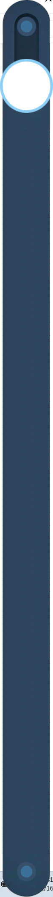
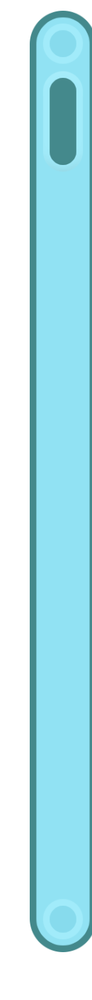

# BigBar

**BigBar — Customizable large scroll bar for Windows**

A big, always-on-top scroll bar that sits on the edge of your screen and scrolls the window you last clicked — browsers, Word, Excel, PDF readers, Notepad, anything that exposes a scrollbar. Click it and it goes to the top or the bottom; drag the knob and the page scrolls proportionally. It never steals focus, and it stays above every other window.

Windows 7 SP1+ / 10 / 11 · single small exe · silent install · MIT licensed.

**[Download the latest release »](https://github.com/YahooEatApple/BigBar/releases/latest)** · **[Help site »](https://yahooeatapple.github.io/BigBar/)**



## Why

Thin, low-contrast scrollbars are hard to find and harder to grab — especially on high-DPI screens and when the window is not in the foreground. BigBar gives you one big, visible target on the screen edge that always controls the last-clicked window.

## What you get

- **A** — click to jump to the top of the document
- **K** — drag to scroll proportionally; hand cursor on hover, grabbing hand while dragging (even outside the bar)
- **B** — click to jump to the end
- **F** — the track, split into two segments at the knob's centre (A→K and K→B), each with its own skin block; the knob floats on top
- **Always on top**, without stealing keyboard focus
- **Skins** — one JSON file per skin with CSS-like blocks for A / B / K / F1 / F2, cursors, hover states, per-language names
- **Three languages** in the menu and tray: English / 中文 / Español
- **Opacity 0–100**, size presets, position & height adjustment with on-bar confirm / cancel buttons
- **Tray icon** with the same menu; `Ctrl` + `Alt` + `S` shows / hides the bar

| Skin | North-land | Menu |
| --- | --- | --- |
|  |  |  |

## Install

1. Download `BigBar-Setup-1.1.0.exe` from Releases and run it.
2. It installs to `%LocalAppData%\Programs\BigBar`, creates desktop + Start-menu shortcuts and enables auto-start.
3. Silent install: `BigBar-Setup-1.1.0.exe /silent`
4. Uninstall: Settings → Apps → **BigBar**, or `Uninstall.exe /uninstall`

## Skins

Skins live in `%AppData%\BigBar\skins`. A default skin plus three samples are written there on first run.

```json
{
  "name": "MySkin",
  "width": 100, "height": 720,
  "language": { "en": "My Skin", "zh": "我的皮肤", "es": "Mi Piel" },
  "elements": [
    { "name": "A", "action": "top",
      "style": {
        "cursor": "pointer",
        "width": "100px", "height": "80px",
        "background-image": "url(MySkin/a.png)",
        "background-repeat": "no-repeat",
        "background-size": "cover",
        "background-position": "0px 0px"
      },
      "mouseover": { "style": { "background-image": "url(MySkin/a_hover.png)" } }
    },
    { "name": "K", "action": "scroll", "style": { "cursor": "pointer", "height": "120px" } },
    { "name": "F1", "style": { "background-image": "url(MySkin/track_top.png)", "background-repeat": "repeat-y" } },
    { "name": "F2", "style": { "background-image": "url(MySkin/track_bottom.png)", "background-repeat": "repeat-y" } }
  ]
}
```

`background-repeat` follows standard CSS (`repeat-x` / `repeat-y` / `no-repeat`), `background-position` accepts negative and split values, `background-size` accepts `auto` / `cover` / `100% auto`. The skin's `width` / `height` decide the bar's size, and switching a skin reloads its files and images immediately.

Files you edit yourself are never overwritten by an update: built-in skins are only upgraded when they carry the program's own marker. If a skin ever gets replaced, a numbered `*.bakN` copy stays next to it.

## Files & settings

| Item | Path |
| --- | --- |
| Program | `%LocalAppData%\Programs\BigBar\BigBar.exe` |
| Settings | `HKCU\Software\BigBar` |
| Skins | `%AppData%\BigBar\skins` |
| Sounds | `%AppData%\BigBar\sounds` |
| Log | `%TEMP%\BigBar.log` |

Upgrading from the old name (`Gunbar`, earlier `BigScrollBar`)? Settings and skins are inherited and copied on first start — see [docs/使用说明.md](docs/使用说明.md) for the full Chinese manual, including the migration notes.

## Known limits

- Chromium-based and some UWP apps do not expose standard scroll info; exclusive full-screen Direct3D windows cannot be covered by a normal topmost window.
- Windows SmartScreen may warn because the build is not code-signed yet.

## License

MIT. See [LICENSE](LICENSE).
